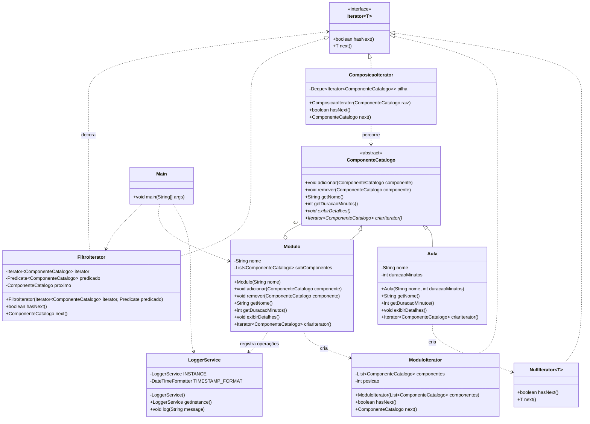
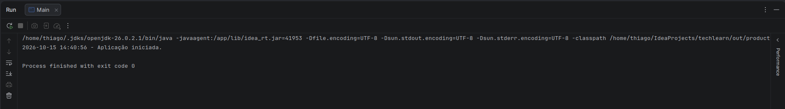
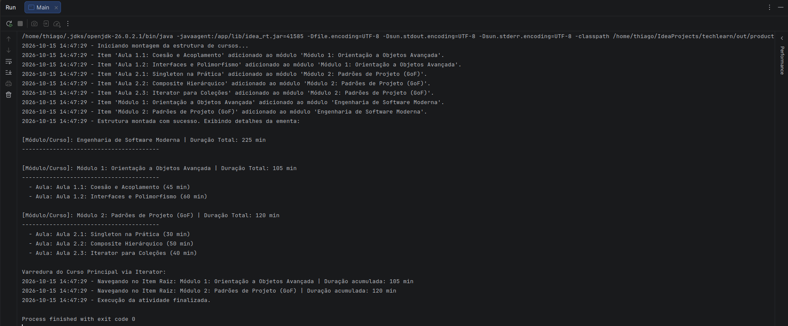
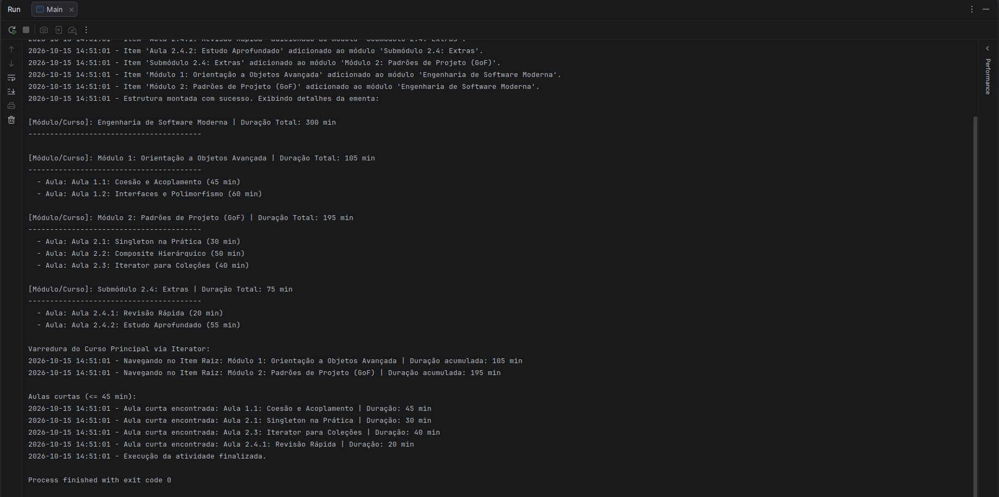
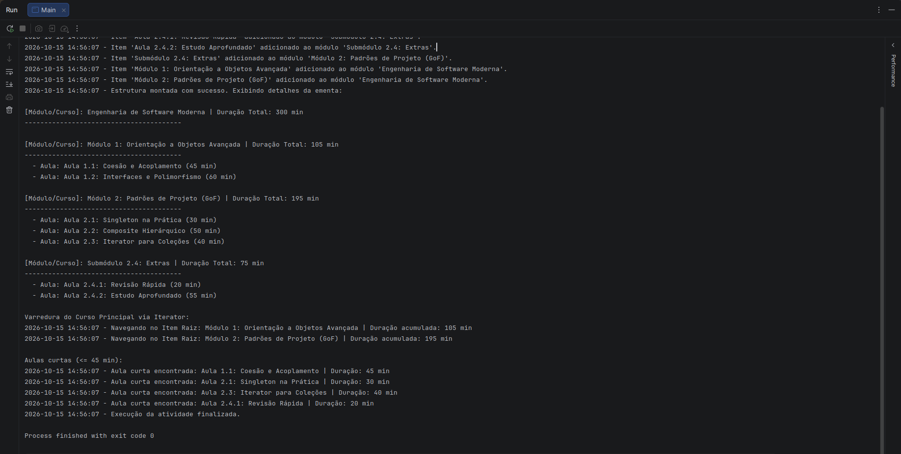

# TechLearn – Composição de Padrões

## 1. Contexto e objetivos

A TechLearn Solutions precisava representar uma estrutura de cursos composta por módulos, submódulos e aulas, calcular a duração total e percorrer essa hierarquia sem acoplar o cliente à estrutura interna das coleções. O projeto demonstra essa solução em Java com três padrões de projeto.

O **Singleton** centraliza o serviço de logging em `LoggerService`, garantindo uma única instância thread-safe. O **Composite** trata cursos, módulos e aulas por meio da abstração `ComponenteCatalogo`, permitindo operar sobre folhas e composições de forma uniforme. O **Iterator** separa a lógica de percurso da estrutura, incluindo iteradores para módulos, percurso em profundidade e filtros decoradores.

## 2. Diagrama de classes

## 3. Passo a passo

### Passo 1 – Singleton

Foi criada a classe `LoggerService` no pacote `techlearn.logging`. A classe usa construtor privado e uma instância eager `static final`, disponibilizada por `getInstance()`. O método `log(String)` imprime a mensagem com timestamp no formato `yyyy-MM-dd HH:mm:ss`.

[Commit da etapa](https://github.com/thiagoleal435/techlearn-padroes-projeto/commit/0674903a0eb9b30ae65885f9e56b9dce1c3004a4)

### Passo 2 – Iterator base e Null Object

Foi criada a interface genérica própria `Iterator<T>`, sem utilizar `java.util.Iterator`. Também foi implementado `NullIterator<T>`, que representa o iterador vazio das folhas do Composite. Assim, uma `Aula` pode participar do percurso sem tratamento especial no código de navegação.

[Commit da etapa](https://github.com/thiagoleal435/techlearn-padroes-projeto/commit/5501be285a6c0cb7ac0c55378fa936249b18316d)

### Passo 3 – Composite

`ComponenteCatalogo` define a abstração comum para `Aula` e `Modulo`. `Aula` funciona como folha, enquanto `Modulo` mantém sua lista interna de componentes, calcula a duração recursivamente e exibe seus filhos. As operações de composição registram mensagens usando o Singleton de logging.

[Commit da etapa](https://github.com/thiagoleal435/techlearn-padroes-projeto/commit/e205b031ffd384356ed2d1861c0c29c17834c083)

### Passo 4 – Iterator do módulo

Foi criado `ModuloIterator`, que percorre a lista de componentes com uma posição interna. O método `Modulo.criarIterator()` passou a retornar esse iterador, mantendo a coleção encapsulada e oferecendo ao cliente apenas as operações `hasNext()` e `next()`.

[Commit da etapa](https://github.com/thiagoleal435/techlearn-padroes-projeto/commit/cd2d639b1dbb6a50444ec0558d4f8c404897a226)

### Passo 5 – Integração no `Main`

O `Main` monta o curso de Engenharia de Software Moderna, com dois módulos e suas aulas, registra as operações e exibe a ementa. Em seguida, percorre os itens do curso principal pelo Iterator e registra o nome e a duração acumulada de cada módulo.

[Commit da etapa](https://github.com/thiagoleal435/techlearn-padroes-projeto/commit/4ff4c293bdd3cf1cc386db46383657cd8bbae03d)

## 4. Decisões de projeto

### Singleton eager

`LoggerService` usa inicialização eager: a instância é criada quando a classe é carregada. Essa alternativa é simples, thread-safe por garantia do mecanismo de inicialização de classes do Java e adequada para um serviço pequeno sempre utilizado pela aplicação. O double-checked locking exigiria sincronização, `volatile` e mais código; o holder idiom também seria uma boa alternativa lazy, mas não é necessário neste caso.

### Encapsulamento do Composite

`Modulo` não possui `getSubComponentes()`. A coleção interna permanece protegida, evitando que o cliente altere a estrutura sem passar por `adicionar()` e `remover()`, que também registram as operações no logger. O acesso à composição acontece pelos comportamentos definidos em `ComponenteCatalogo` e pelo Iterator.

### NullIterator

As folhas retornam `NullIterator`, um Null Object que representa uma coleção vazia. Isso elimina verificações específicas para folhas durante os percursos e permite que iteradores compostos naveguem pela árvore usando apenas `criarIterator()`.

## 5. Resposta à pergunta do desafio

A separação entre a estrutura do Composite e a lógica de percurso do Iterator permitiu adicionar a regra de aulas curtas sem modificar `Aula`, `Modulo` ou `ComponenteCatalogo`. O `ComposicaoIterator` percorre a árvore em profundidade usando os iteradores fornecidos pelos próprios componentes, enquanto o `FiltroIterator` decora esse percurso com um `Predicate` que seleciona aulas com duração menor ou igual a 45 minutos.

Assim, o cliente apenas compõe `new FiltroIterator(new ComposicaoIterator(curso), predicado)` e continua consumindo a mesma interface `Iterator`, sem conhecer a lista interna dos módulos nem alterar a montagem do curso. A nova regra foi adicionada por extensão dos iteradores, preservando o código existente e permitindo reutilizar a mesma estrutura para outros filtros.

### Evidências da execução do desafio

## 6. Como executar

### IntelliJ IDEA

1. Abra a pasta do projeto no IntelliJ IDEA.
2. Em **File > Project Structure > Project**, selecione um JDK configurado, como o `openjdk-26`.
3. Em **Modules**, confirme o módulo `techlearn` e marque `src` como **Sources**.
4. Abra `src/techlearn/Main.java`.
5. Execute `Main.main()` pelo ícone de execução ao lado do método `main`.

O programa monta a hierarquia, exibe a ementa, percorre os módulos e lista as aulas com duração menor ou igual a 45 minutos.

## 7. Histórico de commits

| Etapa | Mensagem | Link |
|---|---|---|
| Estrutura inicial | `chore: estrutura inicial do projeto` | [commit](https://github.com/thiagoleal435/techlearn-padroes-projeto/commit/a6e25c7) |
| 1 – Singleton | `feat(singleton): adiciona LoggerService thread-safe` | [commit](https://github.com/thiagoleal435/techlearn-padroes-projeto/commit/0674903a0eb9b30ae65885f9e56b9dce1c3004a4) |
| Correção de execução | `fix: adiciona ponto de entrada para executar o logger` | [commit](https://github.com/thiagoleal435/techlearn-padroes-projeto/commit/4f6e0952f1118474ab087a96b286a4dfd57d5c0e) |
| 2 – Iterator base | `feat(iterator): adiciona interface Iterator e NullIterator` | [commit](https://github.com/thiagoleal435/techlearn-padroes-projeto/commit/5501be285a6c0cb7ac0c55378fa936249b18316d) |
| 3 – Composite | `feat(composite): adiciona ComponenteCatalogo, Aula e Modulo` | [commit](https://github.com/thiagoleal435/techlearn-padroes-projeto/commit/e205b031ffd384356ed2d1861c0c29c17834c083) |
| 4 – ModuloIterator | `feat(iterator): adiciona ModuloIterator e integra ao Modulo` | [commit](https://github.com/thiagoleal435/techlearn-padroes-projeto/commit/cd2d639b1dbb6a50444ec0558d4f8c404897a226) |
| 5 – Integração | `feat: adiciona Main integrando os três padrões` | [commit](https://github.com/thiagoleal435/techlearn-padroes-projeto/commit/4ff4c293bdd3cf1cc386db46383657cd8bbae03d) |
| 6 – Desafio | `feat(desafio): filtro de aulas com duração <= 45 min` | [commit](https://github.com/thiagoleal435/techlearn-padroes-projeto/commit/232c96c9a72c0b928e352a01f3cf7e152148ab16) |
| Documentação final | `docs: relatório final com prints e resposta do desafio` | [commit](https://github.com/thiagoleal435/techlearn-padroes-projeto/commit/8088ff22c753578070665eec5f440224d21a463b) |